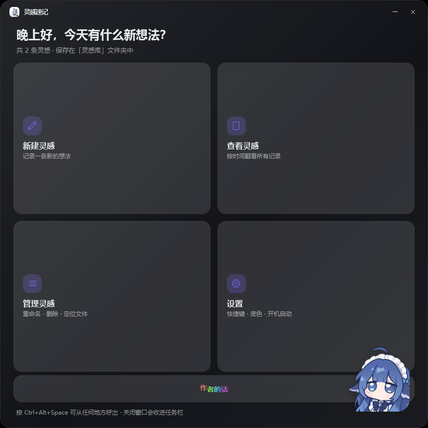
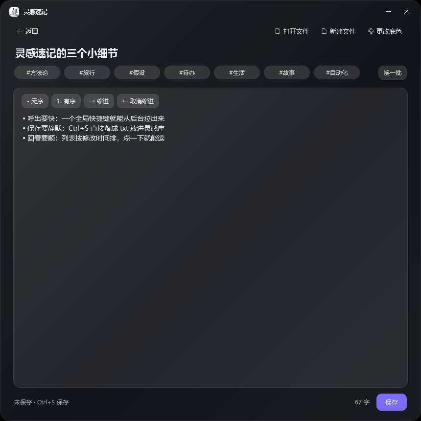
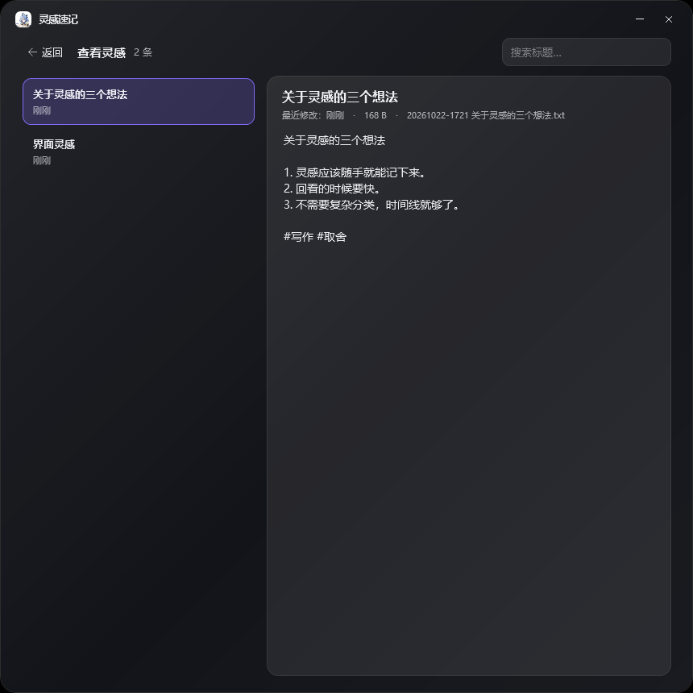
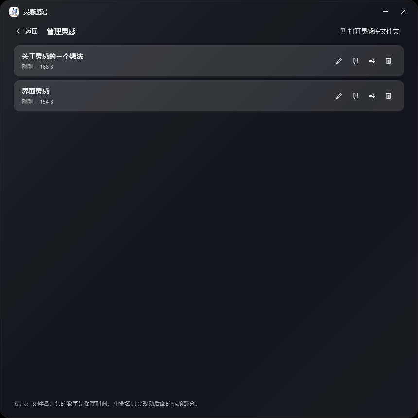
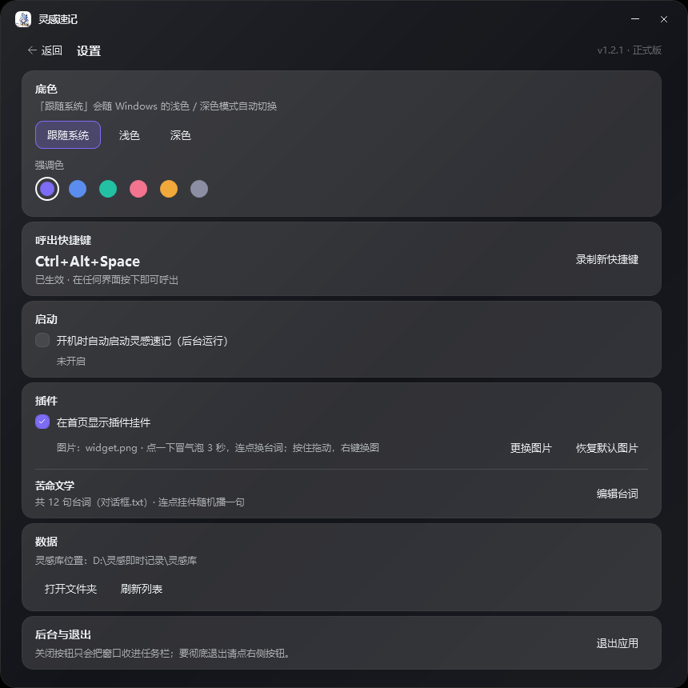
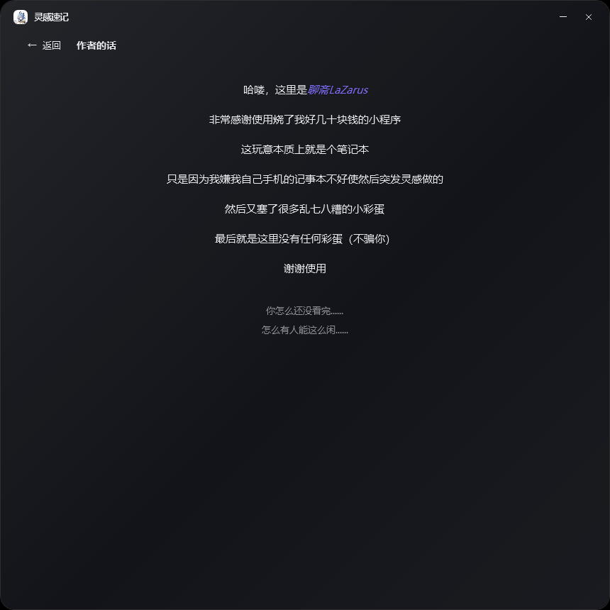
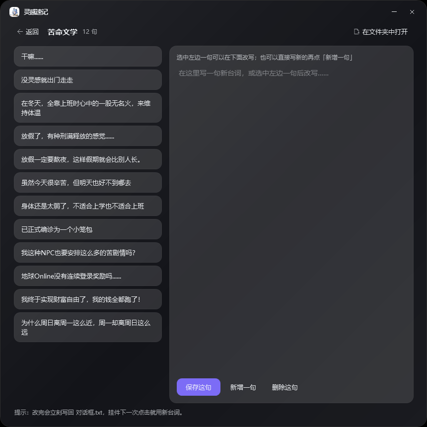

# 灵感速记 v1.2.1（桌面）· 手机版 v1.2.1

一个给 Windows 11 用的「随手记灵感」小工具：平时安静地待在托盘里，按一下全局快捷键就能立刻跳出来写一条，写完自动存成 `.txt` 放进取名为「灵感库」的文件夹。

界面是深色 / 浅色半透明毛玻璃风格，圆角卡片，底色跟随系统并可在设置里手动覆盖。首页右下角有一个可拖动的挂件（默认是克莱门莎贴纸），气泡实时显示「今天你写了 N 条灵感」；点一下会像橡皮鸭一样压扁再弹回，同时冒出一个小气泡（3 秒后自动消失）；短短几秒内连点几次，气泡就随机换一句「对话框.txt」里的台词。按住不放会一直压着顺便能拖动位置，右键可以换成自己的图片，也能在设置里整个关掉。

这些台词在「设置 → 苦命文学」里可以随时增删改。



## 快速开始

1. 双击 **`启动灵感速记.lnk`**（带图标的快捷方式，双击后静默启动，不会弹命令行窗口）；备用入口是 `启动灵感速记.vbs`。
2. 主窗口出现，有四个入口：**新建灵感 / 查看灵感 / 管理灵感 / 设置**。
3. 点右上角 `×` 会把窗口收进任务栏（不是消失），程序继续在后台待命；托盘图标也一直挂着。
4. 在任意界面按 **`Ctrl + Alt + Space`** 立刻呼出 / 收起（快捷键可在「设置 → 呼出快捷键」里改；若该组合已被别的程序占用，会自动改用 `Ctrl + Alt + N`、`Ctrl + Shift + Space` 或 `Ctrl + Alt + L`，并在设置页注明）。

程序是单实例的：重复启动不会开第二个窗口，只会把已经运行的那个叫出来。

> 如果双击 `.lnk` 没反应，可以改用 `启动灵感速记.vbs`，或右键 `灵感速记.ps1` → **使用 PowerShell 运行**，效果相同。

## 界面

### 新建灵感

顶部菜单：**打开文件 / 新建文件 / 更改底色**。

- 标题下方每次进入都会**随机给出 7 个标签词条**（毛玻璃圆角胶囊，等距排列），点一下就把 `#标签` 追加到正文末尾，再点一下取消；右侧「换一批」立刻换一组。
- 正文上方是**列表工具条**：`• 无序` / `1. 有序` / `→ 缩进` / `← 取消缩进`，只作用在光标所在（或选中）的那几行，用来把一堆想法整理成有层级的清单。
- 键盘：`Tab` 缩进、`Shift + Tab` 取消缩进；在 `• ` 或 `1. ` 行末回车会自动续上标记，空条目回车则退出列表。
- 标题留空时自动取正文第一行（超过 24 字会截断）。
- `Ctrl + S` 保存，`Ctrl + N` 立刻开一条新的，`Esc` 回首页。
- 首次保存会写入 `灵感库\20261022-0917 标题.txt`（时间 + 标题），再次保存更新同一个文件，不会生成重复条目。
- 右下角小字显示字数与保存状态。



### 查看灵感

左侧是列表（标题 + 上次修改时间），右侧是阅读区；顶部搜索框可按标题过滤。打开时自动选中第一条。



### 管理灵感

每行右侧四个按钮：**编辑 / 在文件夹中显示 / 重命名 / 删除**。行内显示修改时间与文件大小；删除会先弹确认框。



### 设置

- **底色**：跟随系统 / 浅色 / 深色
- **强调色**：6 个预设（紫、蓝、青、粉、橙、灰）
- **呼出快捷键**：点「录制新快捷键」后按下组合键即可（必须包含 Ctrl / Alt / Shift / Win 之一）
- **启动**：开机自动启动（后台静默运行）
- **插件**：显示 / 隐藏首页挂件、更换图片、恢复默认图片
- **苦命文学**：查看挂件能播的所有台词，并在这里增删改（连点挂件时随机播一句）
- **数据**：灵感库位置、打开文件夹、刷新列表
- **后台与退出**：说明 `×` 只隐藏，彻底退出用「退出应用」



### 作者的话



从首页最下方那一行「作者的话」进入；停留 5 秒，底部会慢慢浮出两行吐槽。

### 苦命文学

左侧是全部台词（12 句起，来自 `对话框.txt`），点一句就在右侧改写；也可以直接写新的再点「新增一句」。改完立刻写回文件，挂件下一次连点就会用上新台词。

- **保存这句**：替换选中的那一句
- **新增一句**：把编辑框内容追加到列表末尾
- **删除这句**：删掉选中的那一句（至少保留一句）
- **在文件夹中打开**：直接定位到 `对话框.txt`



## 数据存放

```
D:\灵感即时记录\
├─ 启动灵感速记.lnk      双击启动（快捷方式，带白底克莱门莎图标）
├─ 灵感速记.ps1        主程序（PowerShell 5.1 + WPF）
├─ 启动灵感速记.vbs     备用的启动脚本（隐藏控制台窗口）
├─ widget.png          首页挂件图片（默认贴纸，可换）
├─ 对话框.txt           挂件随机台词库（可在设置 → 苦命文学里改）
├─ icon-white.png      白底应用图标（托盘 / 任务栏 / 标题栏）
├─ icon.png            原透明底图标（备用）
├─ app.ico             快捷方式用的图标（16~256 多尺寸）
├─ config.json         配置：快捷键 / 底色 / 强调色 / 自启动
├─ 灵感库\              所有灵感，一条一个 .txt
│    └─ 20261022-0917 标题.txt
├─ 预览\                README 用的六张界面截图
├─ 手机版\              手机适配版：单文件网页 + 安卓工程 + apk（见文末）
└─ app.log             仅记录启动与异常，每次启动重写
```

`灵感库` 不存在时会自动创建。文件名开头的 `yyyyMMdd-HHmm` 是保存时间，重命名只会改动后面的标题部分。

## 快捷键一览

| 快捷键 | 作用 |
| --- | --- |
| `Ctrl + Alt + Space` | 全局呼出 / 收起（可自定义） |
| `Ctrl + S` | 保存当前灵感 |
| `Ctrl + N` | 新建一条 |
| `Esc` | 返回首页 / 关闭对话框 |

## 开机自启动

设置里勾选后，会在 `HKCU\Software\Microsoft\Windows\CurrentVersion\Run` 写入名为 `灵感速记` 的启动项，值为 `wscript.exe "...\启动灵感速记.vbs"`，开机后静默启动并驻留托盘。取消勾选即删除该启动项。

首次运行时也会询问一次是否开启。

## 说明与排错

- **运行环境**：Windows 10/11 + 系统自带的 PowerShell 5.1，无需安装任何第三方组件。
- **为什么没有 .exe**：早期版本自带一个 csc 编译的 `启动灵感速记.exe`，因为无数字签名、无下载信誉，运行时会被 Windows 的「Microsoft Defender SmartScreen」拦下（提示“已保护你的电脑 / 无法识别的应用”）。现在改用快捷方式 + 系统签名的 `powershell.exe`，不再触发该拦截；如果仍看到拦截提示，点「更多信息」→「仍要运行」即可。
- **启动方式**：`启动灵感速记.lnk` 指向系统自带的 `powershell.exe`（微软签名程序），双击即可静默启动 `灵感速记.ps1`；`启动灵感速记.vbs` 是等价备用方案。开机自启动写的是 vbs 那条（`wscript.exe`），移动或删掉快捷方式都不影响。
- **快捷键冲突**：默认组合被占用时会自动换一个可用组合并写入 config.json，设置页会用橙色提示「原快捷键被占用，已自动改用 …」；若三个备选都被占用则显示「注册失败：该组合可能已被其他程序占用」，此时手动录制一个即可（`Alt + Space`、`Win + 空格` 这类系统保留组合不可用）。
- **图标**：托盘 / 任务栏 / 标题栏的图标取自同目录的 `icon-white.png`（白底 256×256，缺失时回退到透明底的 `icon.png`）。想换图标，直接用同名 PNG 覆盖即可，重新启动后生效；快捷方式的图标来自 `app.ico`（属性 → 更改图标 可换）。
- **毛玻璃**：Windows 11 上窗口会尝试启用系统亚克力效果；若系统不提供，卡片仍以半透明 + 圆角 + 阴影呈现磨砂观感。
- **修改脚本要保留 BOM**：`灵感速记.ps1` 必须保存为 **UTF-8 with BOM**，否则 PowerShell 5.1 会把中文读成乱码。用记事本另存时注意编码选项。
- **彻底退出**：设置页「退出应用」，或托盘图标右键 → 退出。

## 需求对照

| 需求 | 实现 |
| --- | --- |
| 底色跟随系统 + 圆角毛玻璃卡片 | `Apply-Theme` 读取系统浅/深色，`Shell` 圆角 20 + 亚克力 + 半透明 `CardBg` 卡片 |
| 启动即四选一 | 首页 2×2 卡片：新建 / 查看 / 管理 / 设置 |
| 新建灵感顶部菜单 | 打开文件、新建文件、更改底色 |
| 列表 + 上次修改时间 | 查看、管理两个视图都显示修改时间，管理页另外显示大小与操作按钮 |
| 保存为 txt 到「灵感库」 | 自动建目录，`时间 + 标题.txt`，重复保存覆盖同一文件 |
| 常驻后台 + 自定义全局快捷键 | 托盘驻留 + `RegisterHotKey` 全局热键 + 单实例唤出 |
| 设置含快捷键修改、开机自启动询问、底色修改 | 设置页全部覆盖，首次运行额外弹一次自启动询问 |

### v0.1.1 新增

| 需求 | 实现 |
| --- | --- |
| 新建灵感里增加「列表」功能，便于理清逻辑 | 正文工具条 `• 无序 / 1. 有序 / → 缩进 / ← 取消缩进`，只作用于光标行或选中行；`Tab` / `Shift+Tab` 缩进，回车自动续标记 |
| 每次进入新建灵感随机给出几个词条，毛玻璃圆角等距排列 | `TagPanel` 里 7 个 `TagChip`（94×28、圆角 14、半透明底 + 细边），点一下追加 `#标签` 并高亮，再点取消，「换一批」重新随机（59 个中文词库） |
| 首页右下角插件式挂件，显示「今天你写了 N 条灵感」 | `Update-WhaleBubble` 按当天 `.txt` 数量统计气泡文案（v0.1.1 是手绘小鲸鱼，v0.1.2 已换成可拖动贴纸，见下表） |
| 应用图标改为所给立绘的白底版 | 合成 `icon-white.png`（白底 + 等比居中），标题栏徽标 / 任务栏 / 托盘全部换成它 |
| 启动文件的图标也改为白底立绘 | 生成多尺寸 `app.ico`（16/24/32/48 位图帧 + 64/128/256 PNG 帧），用于 `启动灵感速记.lnk` 的图标 |
| 版本号 0.1.1 | 设置页右上角显示 0.1.1 · 本地单文件 |

### v0.1.2 新增

| 需求 | 实现 |
| --- | --- |
| 设置里增加插件显示开关 | 设置页「插件」卡片：ChkWidget 勾选即显示，取消即隐藏，状态写入 config.json 的 widgetVisible |
| 挂件点击改为「压扁回弹」，长按期间保持压扁 | 去掉上下晃动：按下时 `Invoke-WidgetPress` 从底部中心压扁（70ms 到 1.10×0.84，继续按住 260ms 后加深到 1.14×0.78 并停住），松手时 `Invoke-WidgetRelease` 关键帧回弹（1.12 → 0.95 → 1.02 → 1.0，540ms），像按橡皮鸭；拖动结束则直接回正不弹 |
| 挂件可自行更换图片、可自由移动 | 右键挂件 → 文件对话框换图（复制为 widget<ext> 并记录 widgetImage）；按住拖动，松手后位置写入 widgetRight / widgetBottom，下次启动复原 |
| 初始挂件图片改为所给图 | 桌面已放入 widget.png（610×610 贴纸），圆形圆角裁切 + 投影 |
| 对话框改成点击才出现、显示 3 秒；短时间连点随机播一句台词 | 气泡默认 `Visibility="Collapsed"`；`Invoke-WidgetTap` 记下上次点击时间，4 秒内再次点击就从 `对话框.txt` 里 `Get-Random` 取一句，否则显示「今天你写了 N 条灵感」；`Show-WidgetBubble` 淡入后 3 秒淡出并收起 |
| 版本号 0.1.2 | 设置页右上角显示 0.1.2 · 本地单文件 |

### v1.0 正式版

| 需求 | 实现 |
| --- | --- |
| 设置里增加「苦命文学」，可查看并修改挂件台词 | 新增 `ViewPoems` 视图（列表 + 编辑框 + 保存/新增/删除），台词存在 `对话框.txt`；设置页「插件」卡片下方有入口与句数，改动即时写回文件 |
| 版本号改为 1.0 正式版 | `$script:AppVersion = '1.0'`，标题栏与设置页右上角显示「v1.0 · 正式版」 |
| 适配手机并覆盖 apk | `手机版\灵感速记-手机版.html` 增加同样的苦命文学页（localStorage 持久化），`AndroidManifest.xml` 升到 versionCode 100 / versionName 1.0，重新打包覆盖 `手机版\灵感速记.apk` |

### v1.1

| 问题 / 需求 | 实现 |
| --- | --- |
| 普通权限打不开，必须以管理员运行才能进 | 单实例探测换成 `SendMessageTimeout(0x8002, SMTO_ABORTIFHUNG, 1200ms)` 握手：旧实例可达才退出并把窗口唤出；不可达（例如旧实例是以管理员起的）就记录 `existing instance unreachable, starting a new one` 并直接启动，不再静默退出 |
| 关闭后任务栏不留按钮 | `BtnClose` 改为 `WindowState='Minimized'`，任务栏按钮保留；同时补上一直被漏调的 `Initialize-Tray`，托盘图标常驻，`Ctrl+Alt+Space` 可唤回 |
| 全局热键失效 | `Lingan.HotkeyHost` 从未实例化的 bug 修掉：窗口 `Loaded` 后创建并 `add_Pressed`，随后 `Apply-HotkeyFromConfig`（日志 `hotkey applied: ...`） |
| 手机端也要同样的挂件 | `手机版\灵感速记-手机版.html` 右下角固定挂件，`width: clamp(76px, 24vw, 132px)` 按屏宽等比缩放；点一下压扁回弹 + 气泡 3 秒，4 秒内连点随机播一条苦命文学台词，按住可拖动、长按可换图，设置里「挂件」可关闭 |
| 版本号 1.1 | 桌面「v1.1 · 正式版」；apk 升到 versionName 1.1 / versionCode 110 |
### v1.2.1（桌面）
| 需求 | 实现 |
| --- | --- |
| 首页右下「作者的话」入口 | 整行更扁的按钮（`BtnGoAuthor`，高 54），文字逐字上色：每个字按色相分段取一段渐变，紫→蓝→青→橙→粉，并做轻微上下抖动 |
| 作者的话内容 | `ViewAuthor` 七行居中：首行「哈喽，这里是 *聊斋LaZarus*」（名字斜体强调色），第 6 行「最后就是这里没有任何彩蛋（不骗你）」，末行「谢谢使用」 |
| 停留彩蛋 | 进入 5 秒后底部依次淡入「你怎么还没看完......」「怎么有人能这么闲......」，走开即清除 |
| 问候语点击 | 点标题先显示日期时间（`2026年10月23日 星期五 21:27`）；6 秒内再点进入 9 句彩蛋，逐句推进 |
| 彩蛋播完后 | 再点一次退出程序，并把 `punish` 写进 `config.json`；下次启动标题显示「学乖了吧，下次别玩了」，点一下即恢复 |
| 挂件长按 | 按住 0.48 秒弹出「如果生活把我揍扁，那我就扁扁地离开.......」气泡（与缩放手柄同刻） |
### v1.2.1（手机版）

| 需求 | 实现 |
| --- | --- |
| 标语过一会儿 / 从别的页面回来要恢复原标语并重置点击次数 | `showView('home')` → `renderHome()` 先 `resetGreeting()`（相位、彩蛋下标、上次点击时间、定时器全清）；每次点击 `onGreetTap` 都会 `armGreetIdle()`，12 秒无操作自动复位并把标题写回 `greeting()` |
| 管理灵感底部加「引入灵感」，把手机里的 txt 收进灵感库 | 管理页底部 `#btnImport` + 隐藏的 `<input type="file" multiple accept=".txt">`；`importFiles()` 用 `FileReader` 逐条读取（去 BOM）→ `saveNote()`（apk 内走 `LinganNative.saveNote` 真写文件，网页版写本地存储），文件名沿用 `yyyyMMdd-HHmm 标题.txt`；Java 侧 `onShowFileChooser` 对非图片加 `EXTRA_ALLOW_MULTIPLE`，`onActivityResult` 处理 `getClipData()` 多选 |
| 按住挂件约 0.5 秒（与缩放把手同一时机）输出一句话 | `initWidgetResize` 的 `pointerdown` 里 `widgetLong5Timer`（480ms，与缩放把手同一时机）→ `showBubble('如果生活把我揍扁，那我就扁扁地离开.......', 4200)`，并把 `widgetLongFired` 置真避免触发普通点击；松手 / 取消时清定时器 |
| 「作者的话」换成新文案 | `AUTHOR_TEXT` 七行改为新文本，首行 `*聊斋LaZarus*` 用星号包起来，`pushAuthorChars()` 解析 `*…*` 渲染成斜体强调（`.author-em`） |
| 作者页停留 5 秒，底部慢慢浮现两句 | 页面里预留 `.author-tail`（`min-height: 170px` 的空白），`startAuthorTimer()` 5 秒后给 `.tail-line` 加 `.show`（`opacity` 1.6s 过渡），第二句再延 1.5s；离开页面 `stopAuthorTimer()` 复位 |
| 版本号 | `AndroidManifest.xml` → versionCode 121 / versionName 1.2.1，重新打包覆盖 `手机版\灵感速记.apk` |
### v1.2.0（手机版）

| 需求 | 实现 |
| --- | --- |
| 返回键改成「回上一页」，首页连按两次才退出 | `goBack()` + `navStack`；`window.linganBack()` 先回退，回不去时 1.8 秒内二次返回才返回 `exit`，Java 侧 `onBackPressed()` 拿到 `exit` 才 `finish()`，中间 toast「再按一次返回键退出」 |
| 首页卡片点下去有放大 + 变淡的过渡 | `.card.tapped { transform: scale(.97); opacity: .86 }` + `.view.leaving` / `.view.entering` 进出场动画 |
| 设置里「更换壁纸」，选图自动铺满；启用后隐藏底色 | `pickWallpaper` → `readWallpaper`（canvas 压到 1600px、JPEG 0.82）→ `applyWallpaper` 把图片铺到 `body.has-wall::before`（`background-size: cover`），启用后 `#groupTheme.hidden = true`，可一键清除 |
| 输入第一个字后标签词条联动 | `TAG_SYN` 同义词表 + `relatedTags()`；`refreshTagSuggestions()` 挂到标题/正文 `input`，不足 8 个用随机补 |
| 词条库扩到 150 条、长度 2–5 字 | `TAGVOCAB` 重写为 150 个 2–4 字中文词并去重 |
| 点问候语显示日期时间；再点播彩蛋；播完再点退出，下次启动换标语 | `drumTo()` 滚筒转场 + `onGreetTap()` 状态机：第一次显示 `M月D日 周X HH:mm`，短时间内第二次进彩蛋模式逐句播 `GREET_LINES`，全部播完后再点 → `quitApp()`（优先 `NATIVE.exitApp()`），并写 `localStorage['lingan.punish']`，下次启动标语变成「学乖了吧，下次别玩了」 |
| 首页整行更扁的「作者的话」入口 | `.card.wide` 彩虹渐变动画 + 部分字 `<span class="jitter">` 随机微位移；点进 `#view-author` 居中展示七行文字 |
| 版本号 1.2.0 | `AndroidManifest.xml` → versionCode 120 / versionName 1.2.0，重新打包覆盖 `手机版\灵感速记.apk` |
## 手机版

| 文件 | 用途 |
| --- | --- |
| `手机版\灵感速记.apk` | **已签名的安卓安装包**（353 KB，版本 1.2.1 / versionCode 121，Android 6.0+），传到手机点装即可 |
| `手机版\灵感速记-手机版.html` | 单文件网页 App，不装 apk 也能用：传到手机用浏览器打开，完全离线；「添加到主屏幕」后像原生应用一样全屏 |
| `手机版\Android工程\` | Android WebView 外壳工程，`assets\index.html` 就是上面这份页面，通过 `LinganNative` 桥接读写手机上的真实 txt |
| `手机版\Android工程\build-apk.ps1` | 不用 Gradle 的一键打包脚本（aapt2 → javac → d8 → zipalign → apksigner） |
| `手机版\README.md` | 手机端安装、打包、以及桥接方法说明 |

手机端保留了首页四选一、新建页「打开文件 / 新建文件 / 更改底色」、列表标注最后修改时间、深/浅色与强调色，也带上**随机标签胶囊**、**列表工具条**、**苦命文学页**与 **右下角挂件（按屏宽等比缩放，可拖可换图可关、长按出把手缩放）**、**v1.2.0 的壁纸 / 词条联动 / 问候彩蛋 / 作者的话**；替换的是桌面特有的部分——全局热键改为桌面图标直达，托盘常驻改为本地存储 + 自动草稿，文件位置在 apk 版里是 `Android/data/com.lingan.quicknote/files/灵感库`。

> apk 已在本机编译完成并通过签名校验（v1+v2+v3，`aapt2 dump badging` 显示 `com.lingan.quicknote 1.2.1`、versionCode 121、minSdk 23、target 34，`assets/index.html` 与 `手机版\灵感速记-手机版.html` 哈希一致）。本机没有安卓设备或模拟器，所以没做真机点开验证；如需重新打包，装好 JDK 17 + Android SDK 后执行 `手机版\Android工程\build-apk.ps1 -Sdk "你的SDK路径"`（工程含中文路径时脚本会自动搬到临时英文目录编译，JDK 没进 PATH 时先设 `$env:JAVA_HOME`）。
